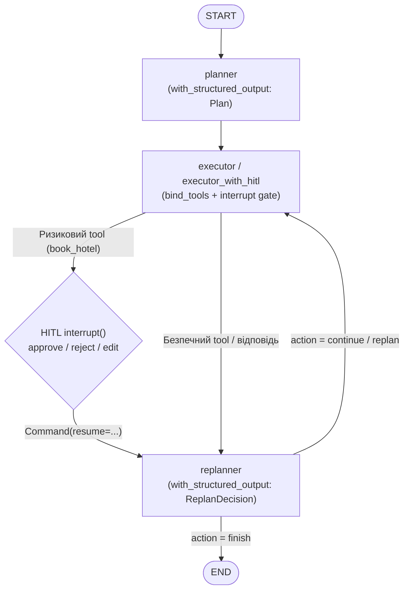

# Plan-and-Execute агент у LangGraph з Memory, Agentic RAG та HITL

Туристичний AI-асистент для планування подорожей Європою, реалізований на базі **LangGraph** та **Google Gemini** (`langchain-google-genai`).

Проєкт реалізує чотири ключові компоненти production-агента:
1. **Plan-and-Execute граф** (`planner → executor → replanner`) зі structured outputs (`Plan`, `ReplanDecision`).
2. **Persistence** через `SqliteSaver` (`agent_state.db`) із відновленням після перезапуску та ізоляцією сесій за `thread_id`.
3. **Agentic RAG** на базі **ChromaDB** (12 документів про подорожі Європою + інструмент `search_knowledge`).
4. **Human-in-the-Loop (HITL)** через `interrupt()` та `Command(resume=...)` для ризикової дії `book_hotel` зі сценаріями `approve`, `reject` та `edit`.

---

## Архітектура

Агент побудований як `StateGraph(PlanExecuteState)` із трьома основними вузлами та умовним циклом виконання:



### Компоненти графа

- **Стан (`PlanExecuteState`)**:
  - `messages`: накопичувана історія повідомлень (`Annotated[list, operator.add]`);
  - `goal`: головна ціль, сформульована `planner`;
  - `plan`: упорядкований список кроків (`list[str]`);
  - `current_step`: індекс поточного кроку (`0-indexed`);
  - `results`: список результатів виконаних кроків;
  - `completed`: прапорець завершення графа;
  - `replan_count`: лічильник перепланувань (захист від зациклення, ліміт `max_replans=2`);
  - `tools_used`: журнал викликаних інструментів (`Annotated[list[str], operator.add]`).
- **`planner`** (`plan_execute.py`): генерує структуровану Pydantic-модель `Plan(goal, steps)` через `with_structured_output(Plan)`.
- **`executor`** (`plan_execute.py`) / **`executor_with_hitl`** (`hitl.py`): бере `plan[current_step]`, викликає LLM із прив'язаними інструментами (`bind_tools`) і виконує поточний крок.
- **`replanner`** (`plan_execute.py`): аналізує прогрес і повертає `ReplanDecision(action, updated_steps, reasoning, final_answer)`:
  - `continue` — перейти до наступного кроку;
  - `replan` — замінити залишкові кроки плану (зберігаючи вже виконані кроки та результати);
  - `finish` — завершити граф і сформувати фінальну відповідь.

---

## Структура проєкту

```text
agents_hw02/
├── config.py           # Завантаження .env, конфігурація Gemini LLM + fallback при 503/504
├── tools.py            # 5 інструментів із Pydantic-схемами та валідацією (+ ризиковий book_hotel)
├── knowledge.py        # ChromaDB (12 документів) + RAG-інструмент search_knowledge
├── plan_execute.py     # LangGraph: Plan, ReplanDecision, PlanExecuteState, planner/executor/replanner
├── hitl.py             # Human-in-the-Loop approval gate (interrupt / approve / reject / edit)
├── main.py             # Демонстраційний CLI-скрипт для всіх 4 завдань
├── agent_state.db      # Файл SQLite зі збереженими checkpoints усіх сесій (генерується SqliteSaver)
├── requirements.txt    # Залежності Python
├── .env.example        # Шаблон змінних середовища (без API-ключа)
├── .gitignore          # Приховує task/, .env, chroma_db/, __pycache__/
└── README.md           # Документація та аналіз результатів
```

---

## Інструменти (Tools) з Pydantic-валідацією

Усі інструменти описані в `tools.py` та `knowledge.py` з явними `args_schema` на базі Pydantic v2:

| Інструмент | Схема валідації | Призначення | Ризиковий (HITL)? |
| :--- | :--- | :--- | :---: |
| `calculate` | `CalculateInput` (regex-перевірка арифметичних символів + безпечний AST-парсер) | Обчислення бюджету та виразів | Ні |
| `get_weather` | `WeatherInput` (`city`, `month`) | Прогноз погоди та поради щодо одягу для європейських міст | Ні |
| `convert_currency` | `CurrencyConvertInput` (`amount > 0`, `Literal["EUR","USD","UAH","GBP","PLN"]`) | Конвертація валют | Ні |
| `search_hotels` | `HotelSearchInput` (`max_price_per_night_eur > 0`, `min_stars` 1..5) | Пошук готелів і хостелів за бюджетом та зірковістю | Ні |
| `search_knowledge` | `SearchKnowledgeInput` (`query`, `top_k` 1..5) | Семантичний пошук у векторній базі знань ChromaDB (Agentic RAG) | Ні |
| `book_hotel` | `BookHotelInput` (`check_in` формату `YYYY-MM-DD`, `nights` 1..30, `total_cost_eur > 0`) | Бронювання готелю з фінансовим списанням | **Так (`RISKY_TOOLS`)** |

---

## База знань (Agentic RAG + ChromaDB)

У `knowledge.py` використовується персистентний клієнт `chromadb.PersistentClient(path="./chroma_db")` із колекцією `travel_knowledge_base` (embedding-модель за замовчуванням `all-MiniLM-L6-v2`).

База знань містить **12 змістовних документів** (по 3–4 речення кожен):
1. `doc_visa_eu` — правила безвізового режиму ЄС / Шенген (90/180 днів, біометричний паспорт, фінансові вимоги).
2. `doc_paris_attractions` — Лувр (зачинений щовівторка, квиток 22 EUR) та Ейфелева вежа.
3. `doc_paris_transport` — метро Парижа (16 ліній), Navigo Day Pass, RER B з аеропорту CDG.
4. `doc_paris_budget` — середні ціни на хостели, готелі 3*–4*, міський податок та харчування.
5. `doc_seasonality` — найкращі місяці для подорожей та офіційні сезони розпродажів.
6. `doc_rome_vatican` — Колізей (18 EUR), музеї Ватикану, дрес-код у соборі Святого Петра.
7. `doc_barcelona_guide` — Саграда Фамілія, парк Гуель, проїзний T-casual.
8. `doc_lowcost_luggage` — габарити безкоштовної ручної поклажі Ryanair (`40x20x25 см`) і Wizz Air (`40x30x20 см`).
9. `doc_travel_insurance` — вимоги до медичного страхування в Шенгені (покриття від 30 000 EUR).
10. `doc_tourist_safety` — безпека туристів, кишенькові крадіжки, єдиний номер 112.
11. `doc_tax_free` — повернення ПДВ (Tax Free) у Франції, Іспанії та Італії.
12. `doc_eu_trains` — швидкісні потяги TGV/Frecciarossa/AVE та проїзний Eurail Pass.

Інструмент `search_knowledge` має чіткий docstring, який розмежовує довідкові запити (RAG) та інструменти дій/обчислень — завдяки цьому агент самостійно вирішує, коли звертатися до ChromaDB.

---

## Human-in-the-Loop (HITL) Flow

Ризикова дія `book_hotel` входить у набір `RISKY_TOOLS = {"book_hotel"}`. Перед її викликом вузол `executor_with_hitl` (`hitl.py`) викликає `interrupt({...})`:
- Граф негайно зупиняється, а поточний стан зберігається у `SqliteSaver` (`agent_state.db`).
- Оператору показуються точні деталі дії: номер і опис кроку, назва інструмента та всі аргументи (`hotel_name`, `city`, `check_in`, `nights`, `total_cost_eur`).
- Граф відновлюється через `app_hitl.invoke(Command(resume=...), config=config)` із трьома підтримуваними рішеннями:
  - **Approve**: `{"action": "approve"}` (або `{"approved": True}`) — виконує `book_hotel` із параметрами агента та додає запис у реєстр `BOOKING_LEDGER`.
  - **Reject**: `{"action": "reject", "reason": "..."}` (або `{"approved": False, ...}`) — **не** викликає `book_hotel`, записує причину відмови в `results`, після чого `replanner` коректно завершує сесію.
  - **Edit**: `{"action": "edit", "args": {"nights": 3, "total_cost_eur": 330.0}}` — об'єднує правки оператора з початковими аргументами, валідує їх через Pydantic-схему `BookHotelInput` і виконує бронювання зі зміненими параметрами.

---

## Інструкція запуску

### 1. Встановлення залежностей

```bash
pip install -r requirements.txt
```

### 2. Налаштування змінних середовища (`.env`)

Скопіюйте `.env.example` у `.env` та вкажіть ваш ключ Gemini API:

```bash
copy .env.example .env
```

Вміст `.env`:

```env
GOOGLE_API_KEY=ваш_ключ_gemini
GEMINI_MODEL=gemini-flash-lite-latest
```

> **Примітка:** файл `.env` та директорія `task/` додані до `.gitignore`, тому секрети та матеріали завдання не потрапляють у Git.

### 3. Запуск демонстрацій

Запуск усіх 4 завдань послідовно (генерує/оновлює `agent_state.db`):

```bash
python main.py --task all
```

Або запуск окремих завдань:

```bash
python main.py --task 1   # Plan-and-Execute (3 сценарії, включно з replanning)
python main.py --task 2   # Persistence (SqliteSaver, відновлення після зупинки, ізоляція thread_id)
python main.py --task 3   # Agentic RAG (ChromaDB + автономний вибір інструментів)
python main.py --task 4   # Human-in-the-Loop (approve / reject / edit)
```

---

## Аналіз результатів виконання

Усі 4 модулі протестовано на реальних викликах **Gemini API** (`gemini-flash-lite-latest` із резервним fallback-ланцюжком у `config.py`).

### Завдання 1 — Plan-and-Execute та динамічне перепланування
- **Приклад 1 (Базовий, 3/3 кроки)**: `get_weather` → `calculate((4 * 110) + 18 = 458)` → `convert_currency(458 EUR = 20630.63 UAH)`. Replanner коректно підтверджував `continue` на кожному кроці й завершив після 3-го кроку.
- **Приклад 2 (Комплексний, 4/4 кроки)**: агент поєднав `search_knowledge` (безвіз + графік Лувру), `search_hotels` (`Hotel Ibis Paris Bastille`, 115 EUR/ніч), `calculate(115 * 3 = 345)` та `convert_currency(345 EUR = 15540.54 UAH)`.
- **Приклад 3 (Динамічний Replanning)**: на запит знайти 4* готель у Парижі до 60 EUR/ніч перший крок повернув `НЕ ЗНАЙДЕНО`. Вузол `replanner` виконав **`REPLAN #1`** (`replan_count = 1`), замінив залишкові кроки на пошук доступної альтернативи (`Generator Paris Hostel`, 2*, 42 EUR/ніч) і коректно обчислив вартість 2 ночей (`84 EUR`).

### Завдання 2 — Persistence (`SqliteSaver`) та `agent_state.db`
- Сесія `session-paris-001` була зупинена після 1-го кроку (`step=1/3`, `next=('replanner',)`), після чого SQLite-з'єднання було повністю закрито.
- Після повторного відкриття `agent_state.db` і перекомпіляції графа виклик `get_state(config)` відновив план і результат 1-го кроку, а `invoke(None, config)` виконав лише кроки 2 і 3 (без повторного виклику `planner` чи кроку 1).
- Паралельна сесія `session-rome-002` збереглася в тому самому файлі `agent_state.db` з повністю ізольованим станом.

### Завдання 3 — Agentic RAG (ChromaDB)
- **Довідковий запит** (безвіз + Лувр): агент автономно викликав **лише** `['search_knowledge', 'search_knowledge']` і точно відповів про 90/180 днів, квиток 22 EUR та вихідний у вівторок.
- **Обчислювальний запит** (`(125 * 4) + 45 + 30` у EUR та UAH): агент викликав **лише** `['calculate', 'convert_currency']` — без жодного звернення до ChromaDB (`575 EUR = 25900.90 UAH`).
- **Гібридний запит** (багаж Ryanair + погода Барселони + розрахунок): агент самостійно скомбінував `['search_knowledge', 'get_weather', 'calculate']`, повернувши габарити `40x20x25 см`, прогноз `+17..+23°C` і суму `375 EUR`.

### Завдання 4 — Human-in-the-Loop (`interrupt()` / `Command(resume=...)`)
- **Approve (`hitl-approve-001`)**: зупинка перед `book_hotel` (`BOOKING_LEDGER`: 0 записів) → після `Command(resume={"action": "approve"})` створено бронювання `BK-1001` (`Hotel Ibis Paris Bastille`, 3 ночі, 345 EUR).
- **Reject (`hitl-reject-002`)**: зупинка перед `book_hotel` (`880 EUR`) → після `Command(resume={"action": "reject", "reason": "Занадто дорого для нашого бюджету"})` кількість записів у `BOOKING_LEDGER` не змінилася (`1 → 1`), ризикова дія не виконалась, агент повідомив про скасування.
- **Edit (`hitl-edit-003`)**: зупинка перед `book_hotel` (5 ночей / 550 EUR) → оператор змінив параметри на `{"nights": 3, "total_cost_eur": 330.0}` → бронювання `BK-1002` виконано саме з відредагованими значеннями (`3 ночі`, `330.00 EUR`).

### Збережені сесії у `agent_state.db`
У фінальному файлі `agent_state.db` збережено повну історію checkpoints для 5 незалежних `thread_id`:
- `session-paris-001` (перевірка зупинки та відновлення після перезапуску)
- `session-rome-002` (перевірка незалежності сесій)
- `hitl-approve-001` (HITL сценарій підтвердження)
- `hitl-reject-002` (HITL сценарій відхилення)
- `hitl-edit-003` (HITL сценарій редагування параметрів)

### Практичні спостереження
1. **Передача повного запиту в `executor`**: на початковій ітерації, коли `executor` отримував лише узагальнену `goal` замість початкового запиту користувача, модель інколи втрачала конкретні числа для `calculate`. Додавання початкового запиту користувача у промпт `executor` повністю усунуло цю проблему.
2. **Стійкість до перевантажень LLM API**: під час тестування API Gemini періодично повертав тимчасові помилки `503 UNAVAILABLE` / `504 DEADLINE_EXCEEDED` на окремих endpoint-ах. Реалізований у `config.py` механізм автоматичного fallback між моделями Gemini та повторних спроб із затримкою забезпечив стабільне проходження всіх багатокрокових сценаріїв.
